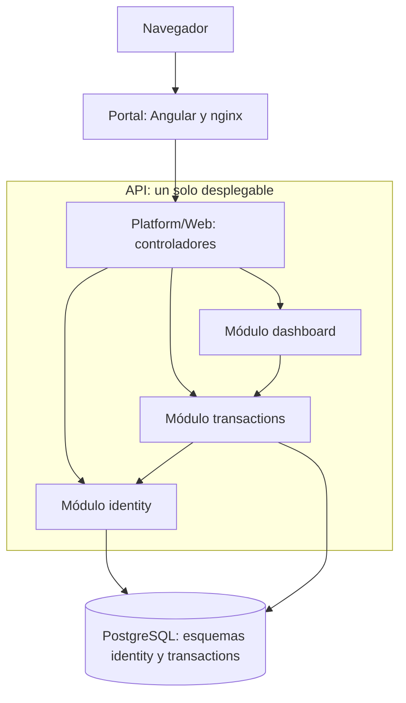

# Budget Tracker

Aplicación web para que un pequeño negocio registre sus ingresos y gastos, los clasifique en un
catálogo de categorías, fije presupuestos y compare lo gastado con lo planeado.

- **Problema que resuelve:** muchos negocios pequeños llevan sus ingresos y gastos en hojas de cálculo
  o cuadernos actualizados sin orden. Nadie sabe el saldo del momento sin sumar a mano, y un registro
  borrado o mal clasificado por error no se puede rastrear
  ([`docs/03-product/problem-framing.md`](docs/03-product/problem-framing.md)).
- **Usuarios:** el administrador del negocio, que crea las cuentas y mantiene el catálogo y los
  presupuestos, y las personas que registran y consultan sus propios movimientos.

Proyecto final del curso **Métricas y Estándares de Calidad**, docente José Miguel Llanos Mosquera:
además de construir la aplicación, se mide su mantenibilidad y se mejora con base en esas métricas.

## Integrantes

| Nombre | Usuario de GitHub | Rol y aporte |
|---|---|---|
| Victor Alfonso Tovar Ramirez | [@Naudi13](https://github.com/Naudi13) | Proyecto individual: requisitos, arquitectura, desarrollo, pruebas, medición y documentación |

## Requisitos

El detalle, con criterios de aceptación y trazabilidad, está en [`docs/requisitos.md`](docs/requisitos.md).

| ID | Requisito funcional |
|---|---|
| RF-01 | Administrar cuentas: crear, listar, inactivar, reactivar y eliminar |
| RF-02 | Activar una cuenta o restablecer la contraseña con un enlace de un solo uso |
| RF-03 | Iniciar sesión |
| RF-04 | Crear categorías y subcategorías |
| RF-05 | Gestionar el ciclo de vida de una categoría o subcategoría |
| RF-06 | Registrar un movimiento con una o más líneas de detalle |
| RF-07 | Consultar el historial de movimientos según el rol |
| RF-08 | Eliminar un movimiento indicando la razón |
| RF-09 | Gestionar el presupuesto de una categoría por período |
| RF-10 | Ver el panel frente al presupuesto, global o por categoría |

| ID | Requisito no funcional | Estado |
|---|---|---|
| RNF-01 | Mantenibilidad: ningún método supera una complejidad ciclomática V(G) de 10 | Cumple; el CI lo verifica |
| RNF-02 | Seguridad: tras 5 intentos fallidos con un mismo correo en 15 minutos, se responde `429` | Cumple |
| RNF-03 | Seguridad: las contraseñas se guardan como hash con sal y nunca en texto plano | Cumple |

## Arquitectura

**Monolito modular con capas dentro de cada módulo.** La aplicación se despliega como una sola unidad
dividida en tres módulos, `identity`, `transactions` y `dashboard`, que solo se comunican a través de
sus fachadas públicas. Se eligió porque el dominio tiene tres áreas claras, el equipo es pequeño y
un solo desplegable es más simple de operar que varios servicios; la separación por módulos la
verifican el compilador y pruebas de arquitectura. Justificación, alternativas y compromisos en
[`docs/arquitectura.md`](docs/arquitectura.md).



## Tecnologías

| Parte | Tecnología |
|---|---|
| Lenguaje principal y API | C# con ASP.NET Core 10 |
| Portal web | Angular 21 con TypeScript, servido por nginx |
| Base de datos | PostgreSQL 17 |
| Migraciones | FluentMigrator |
| Pruebas | xUnit, NetArchTest, Testcontainers, Vitest y Postman |
| Contenedores | Docker Compose |
| Integración continua | GitHub Actions |
| Métricas | `lizard` 1.25.0 y un medidor propio con Roslyn |

## Instalación y ejecución

**Requisitos previos:** Docker Desktop con Docker Compose, Git y, para las pruebas, .NET SDK 10 y
Node.js 22.12 o superior. Los puertos `8080` y `5432` deben estar libres.

1. Clonar el repositorio y entrar a `infra`:

   ```bash
   git clone https://github.com/Naudi13/budget-tracker.git
   cd budget-tracker/infra
   ```

2. Crear el archivo de entorno; los valores de ejemplo funcionan tal cual:

   ```bash
   cp .env.example .env
   ```

3. Levantar la base de datos, las migraciones, la API y el portal:

   ```bash
   docker compose up -d --build --wait
   ```

4. Abrir `http://localhost:8080` e iniciar sesión con un usuario de prueba, solo para uso local:

   | Rol | Correo | Contraseña |
   |---|---|---|
   | `ADMIN` | `admin@budgettracker.test` | `Admin-2026!` |
   | `USER` | `usuario@budgettracker.test` | `Usuario-2026!` |

   Para ver la aplicación con datos de ejemplo: `sh scripts/seed-demo.sh`.

Para detener la aplicación: `docker compose down`. El manual completo, con problemas frecuentes,
está en [`infra/README.md`](infra/README.md).

### Pruebas

Desde `src/api`; las de integración y end-to-end necesitan Docker:

```bash
dotnet build -c Release
dotnet test --project tests/unit -c Release --no-build
dotnet test --project tests/boundary -c Release --no-build
dotnet test --project tests/module-integration -c Release --no-build
dotnet test --project tests/end-to-end -c Release --no-build
```

Desde `src/portal`:

```bash
npm ci
npx ng test --watch=false
```

## Métricas

Se aplican seis métricas, cada una con su ficha en [`docs/metricas/fichas.md`](docs/metricas/fichas.md):
complejidad ciclomática, líneas de código y comentarios, Índice de Mantenibilidad, suite CK, costo de
mantenimiento por tipo y duplicación.

Para medir, desde la raíz del repositorio:

```bash
python -m pip install -r metricas/requirements.txt
python metricas/medir.py --nombre antes
python metricas/comparar.py antes despues
```

Con la aplicación en marcha, `--base-url http://localhost:8080` prueba además el límite de intentos
de inicio de sesión. Detalle en [`metricas/README.md`](metricas/README.md).

| Indicador | Antes | Después |
|---|---|---|
| Métodos con V(G) > 10 | 1 | 0 |
| V(G) máximo | 17 | 10 |
| Clases con WMC > 20 | 6 | 6 |
| Clases con MI < 65 | 15 | 16 |
| Mantenimiento preventivo | 0 % | 0.8 % |
| Sexto intento fallido de inicio de sesión | `401` | `429` |

Resultados completos en [`docs/metricas/antes`](docs/metricas/antes/resultados.md),
[`docs/metricas/despues`](docs/metricas/despues/resultados.md) y
[`docs/metricas/comparacion.md`](docs/metricas/comparacion.md).

## Mejoras

Implementadas y medidas antes y después:

| Mejora | Técnica | Efecto |
|---|---|---|
| Dividir `MovementRules.Validate` | Extract Method | V(G) de 17 a 3; RNF-01 se cumple |
| Limitar los intentos de inicio de sesión | Nueva clase `SignInAttempts` | El sexto intento responde `429`; RNF-02 se cumple |
| Verificar RNF-01 en cada pull request | Job `complexity` en el CI | La complejidad no puede volver a superar 10 sin que falle el CI |

Propuestas, priorizadas por riesgo y esfuerzo: separar responsabilidades en `MovementRules` y en los
casos de uso de movimientos, reemplazar el `switch` del filtro de errores, reducir el tamaño de los
repositorios y unificar el código duplicado entre la API y las migraciones. El plan completo, con el
efecto esperado sobre cada métrica, está en [`docs/metricas/analisis.md`](docs/metricas/analisis.md).

## Estructura del repositorio

```text
README.md
docs/
  requisitos.md        requisitos funcionales y no funcionales, y trazabilidad
  arquitectura.md      arquitectura, diagramas y justificación
  metricas/            fichas, mediciones antes y después, comparación y análisis
  05-architecture/     decisiones de arquitectura (ADR)
  04-requirements/     historias de usuario
  11-quality/          casos de prueba
infra/                 Docker Compose y scripts de verificación
metricas/              scripts y medidor de métricas
src/
  api/                 API en ASP.NET Core, con sus pruebas en tests/
  portal/              portal en Angular, con sus pruebas
  db/                  migraciones con FluentMigrator
```

**Informe final:** `docs/informe-final.pdf`, pendiente de entrega.

## Licencia y estado

Distribuido bajo la licencia MIT; ver [`LICENSE`](LICENSE).

**Estado:** aplicación funcional con los 10 RF y los 3 RNF cumplidos, y medición antes y después
terminada. Pendientes: informe final y versión de entrega.
