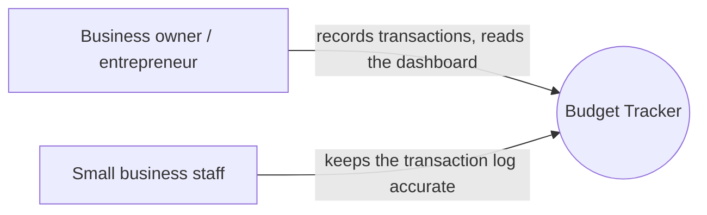

# 01 — Overview

## What it does

A single deployable web application that lets a small business or an
entrepreneur record income and expenses and read the state of their finances
from one dashboard. It is one deployable application with one database,
released as a single unit, even though its source lives in separate
documentation, backend, frontend, and database repositories.

| Capability | Description |
|---|---|
| User account | Accounts created by an administrator and activated by their owner; roles `USER` and `ADMIN` |
| Income tracking | Register a transaction with a date and description, and one or more detail lines (subcategory and amount) |
| Expense tracking | Register a transaction the same way, using an expense subcategory instead |
| Category management | Create custom categories and subcategories per type; delete only when unused, deactivate otherwise |
| Budgeting | Set, change or delete an amount limit per category for a defined period |
| Transaction history | View recorded transactions and delete one (soft delete — hidden, never permanently removed) |
| Balance | Compute the net balance as total income minus total expenses |
| Dashboard | A single view with KPIs (total income, total expenses, net balance) and the 5 most recent transactions, for a fast read of financial health |

## System context

No external system is called yet — V1 has no bank integration or other
provider; see [`scope.md`](./scope.md). The container inside this one box is
drawn in
[`../05-architecture/modular-monolith.md`](../05-architecture/modular-monolith.md).

## Who it is for

| Audience | Uses it to |
|---|---|
| Business owner / entrepreneur | Record daily income and expenses and know the current balance without a spreadsheet |
| Small business staff | Keep the transaction log accurate as money moves in and out |

## Problem it solves

Before this system, entrepreneurs and small businesses track income and
expenses in scattered spreadsheets or notebooks, updated inconsistently.
Balance problems are noticed only after the fact, because no single view
answers "how much did we make, how much did we spend, and what is left"
without manually adding up several sheets.

## Constraints

| Constraint | Why |
|---|---|
| One deployable application | A single small team or solo founder, no operating budget for running several deployments |
| One relational database | Income, expenses, and balance must stay consistent within one transaction |
| Source split across five repositories | `bud-tack-docs`, `-api`, `-portal`, `-db`, and `-infra` are versioned separately but released together; see [`../00-governance/git-conventions.md`](../00-governance/git-conventions.md) |
| A budget is a stored limit, not a comparison yet | V1 records the limit per category and period; checking actual spend against it comes later |

---

**Related:** [`./scope.md`](./scope.md) · [`./glossary.md`](./glossary.md)
