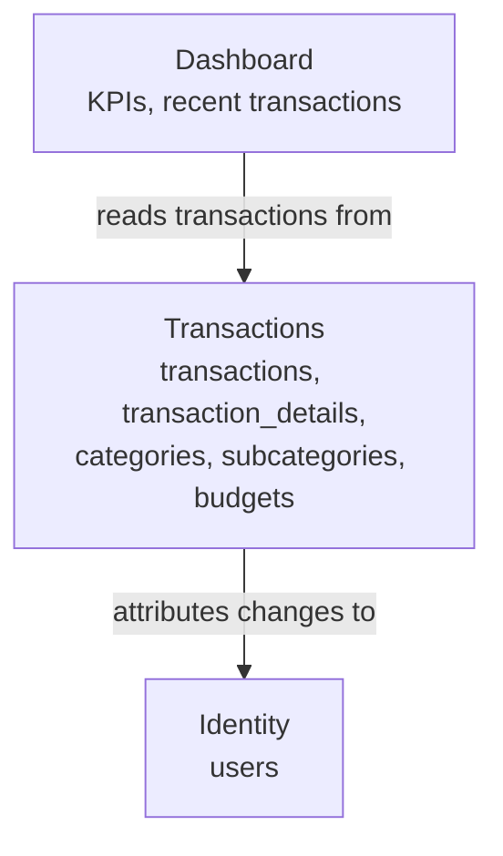

# 02 — Domain Map

## Bounded contexts

## Relationship legend

| Arrow | Meaning |
|---|---|
| `attributes changes to` | Every write in Transactions records which user made it (`created_by` / `updated_by`); Identity owns no financial data, only the account used to sign in |
| `reads transactions from` | Read-only; Dashboard owns no transaction data. Total income, total expenses, and net balance are computed on read from Transactions per **BR-03**, and the 5 most recent transactions are read the same way, unaggregated |

## How this map is used

Every bounded context above becomes exactly one module in
[`module-boundaries.md`](./module-boundaries.md), owning the tables named here.
A context with no box on this map has no reason to be its own module either.

---

**Related:** [`./entities-and-rules.md`](./entities-and-rules.md) · [`./module-boundaries.md`](./module-boundaries.md)
