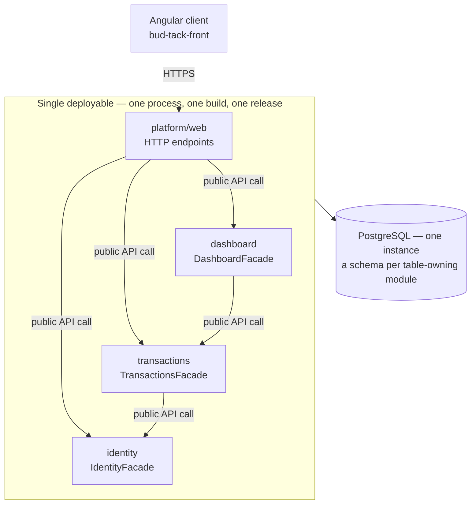

# 05 — Modular Monolith

## What it is

A **modular monolith** is one deployable, built and released as a unit, divided
inside into modules. Each module is a bounded context: it owns its tables,
exposes a narrow public API, and keeps everything else internal. Those three
terms are defined in
[`module-boundaries.md`](../02-domain/module-boundaries.md) and are used here
unchanged.

## One deployment, three modules

The three modules come straight from the domain map, and the arrows between
them match `module-boundaries.md`: `transactions` calls `identity` to attribute a
change to a user, and `dashboard` calls `transactions` to read totals and recent
transactions. The Angular client is not a module: it is a separate repository
that calls the one public API, and how its build reaches production is decided
in [`../10-devops/README.md`](../10-devops/README.md). Arrows cross a boundary
only through a public API, and never form a cycle. The single shared database,
unlike the course standard's database per domain, is an exception recorded in
[`ADR-004`](./decisions/records/ADR-004-shared-database-and-per-piece-repositories.md).

## Anatomy of a module

| Part | Rule |
|---|---|
| Public API | One entry point, `<Module>Facade` — the only symbol other modules may import |
| Internal | Domain, application and persistence code; importable only from inside the module |
| Owned tables | Written by this module alone; others read them through the public API |
| Tests | `module-integration` tests exercise the public API; internals are covered by `unit` tests |

## How two modules talk, inside one process

| Mechanism | Use it when | What it is not |
|---|---|---|
| Public API call | The caller needs an answer now, inside the same transaction | Not a network hop — an ordinary in-process method call |
| In-process event | Two or more modules react to something that already happened | Not a broker or a queue — synchronous dispatch, same process, same release |

Both are plain function calls behind a boundary the build enforces. If a call
between modules starts needing a timeout or a retry policy, the boundary is in
the wrong place. Every cross-module call in V1 is a public API call; no
in-process event is needed yet.

## When it applies, and when it is over-engineering

| Situation | Verdict |
|---|---|
| Two or more bounded contexts on the domain map | Modular monolith |
| Two or more people changing unrelated business areas in the same week | Modular monolith |
| One bounded context on the domain map | Over-engineering — use [`layered-architecture.md`](./layered-architecture.md) |
| Boundaries drawn before the domain is understood | Over-engineering — the lines freeze in the wrong place |
| A folder per technical concern, called a module | Not a module at all; that is a layer |

This project has three bounded contexts on its domain map, so it is modular;
[`ADR-001`](./decisions/records/ADR-001-modular-monolith-as-default.md) records
the choice.

---

**Related:** [`../02-domain/module-boundaries.md`](../02-domain/module-boundaries.md) · [`./boundary-enforcement.md`](./boundary-enforcement.md)
