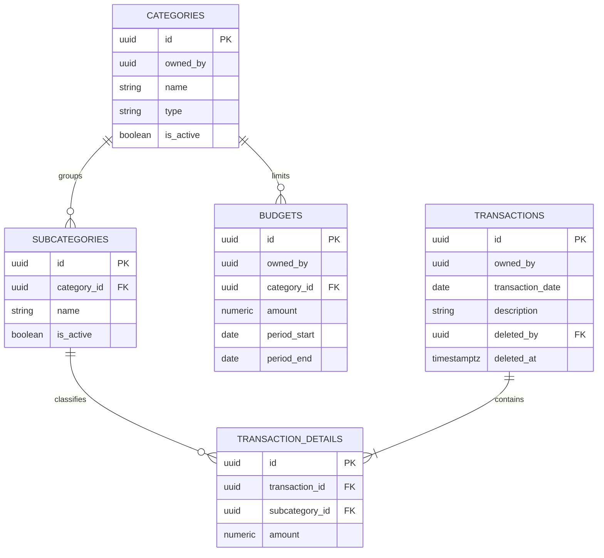

# 06 — Data Models

## Entities and ownership

| Entity | Table | Owning module | Key attributes |
|---|---|---|---|
| User | `identity.users` | `identity` | name, email, password_hash |
| Category | `transactions.categories` | `transactions` | name, type (income \| expense), is_active |
| Subcategory | `transactions.subcategories` | `transactions` | category reference, name, is_active |
| Transaction | `transactions.transactions` | `transactions` | transaction date, description |
| Transaction detail | `transactions.transaction_details` | `transactions` | transaction reference, subcategory reference, amount |
| Budget | `transactions.budgets` | `transactions` | category reference, amount, period start, period end |

`dashboard` owns no table; it reads through `TransactionsFacade`, computed per
**BR-03**. Invariants: [`entities-and-rules.md`](../02-domain/entities-and-rules.md).
Schema default: [`database-conventions.md`](./database-conventions.md), whose
shared-instance exception is [`ADR-004`](../05-architecture/decisions/records/ADR-004-shared-database-and-per-piece-repositories.md).

Deactivation, per **BR-05**, is `is_active = false`: new transactions and budgets
stop offering the row, existing links stay, and `ON DELETE RESTRICT` still refuses a delete.

## Relationships

Audit columns are omitted for clarity, except `transactions`'s soft-delete columns.

Every foreign key above stays inside `transactions`, `ON DELETE RESTRICT` (**BR-05**).

## Cross-module references

| Table | Column | Points to | Enforced by |
|---|---|---|---|
| `categories`, `transactions`, `budgets` | `owned_by` | `identity.users` | The authenticated user id; every read and write is filtered by it, so one business never sees another's data |
| Every table in `transactions` (`categories`, `subcategories`, `transactions`, `transaction_details`, `budgets`) | `created_by`, `updated_by` | `identity.users` | `IdentityFacade`, not a database foreign key — see [`database-conventions.md`](./database-conventions.md) |
| `transactions.transactions` | `deleted_by` | `identity.users` | Same as above; set only together with `deleted_at`, never alone (**BR-04**) |

A reference to `identity.users` is a plain column validated by `IdentityFacade`,
never a `REFERENCES` constraint, because it crosses a module boundary.

---

**Related:** [`../02-domain/entities-and-rules.md`](../02-domain/entities-and-rules.md) · [`./database-conventions.md`](./database-conventions.md)
