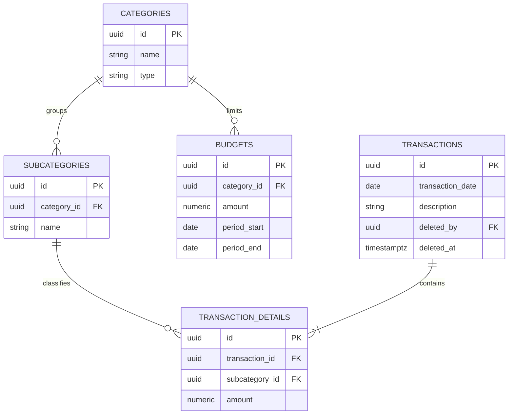

# 06 — Data Models

## Entities and ownership

| Entity | Table | Owning module | Key attributes |
|---|---|---|---|
| User | `identity.users` | `identity` | name, email, password_hash |
| Category | `transactions.categories` | `transactions` | name, type (income \| expense) |
| Subcategory | `transactions.subcategories` | `transactions` | category reference, name |
| Transaction | `transactions.transactions` | `transactions` | transaction date, description |
| Transaction detail | `transactions.transaction_details` | `transactions` | transaction reference, subcategory reference, amount |
| Budget | `transactions.budgets` | `transactions` | category reference, amount, period start, period end |

`dashboard` owns no table: it reads every figure it shows through
`TransactionsFacade`, computed at read time per **BR-03**. Invariants live in
[`entities-and-rules.md`](../02-domain/entities-and-rules.md); this table only
adds the table name and the owning module, named with its schema per
[`database-conventions.md`](./database-conventions.md) — the shared instance
behind that default is the exception [`ADR-004`](../05-architecture/decisions/records/ADR-004-shared-database-and-per-piece-repositories.md) records.

## Relationships

Audit columns (`created_by`, `updated_by`) are omitted below for clarity, except
`transactions`'s soft-delete columns — see the Cross-module references table.

Every foreign key above stays inside the `transactions` schema, declared
`ON DELETE RESTRICT`, enforcing **BR-05** in the data as well as in the facade.

## Cross-module references

| Table | Column | Points to | Enforced by |
|---|---|---|---|
| Every table in `transactions` (`categories`, `subcategories`, `transactions`, `transaction_details`, `budgets`) | `created_by`, `updated_by` | `identity.users` | `IdentityFacade`, not a database foreign key — see [`database-conventions.md`](./database-conventions.md) |
| `transactions.transactions` | `deleted_by` | `identity.users` | Same as above; set only together with `deleted_at`, never alone (**BR-04**) |

`identity` is a schema no other module writes to. A reference to `identity.users`
is validated by `IdentityFacade` at write time and stored as a plain column,
never a `REFERENCES` constraint, because it crosses a module boundary.

---

**Related:** [`../02-domain/entities-and-rules.md`](../02-domain/entities-and-rules.md) · [`./database-conventions.md`](./database-conventions.md)
