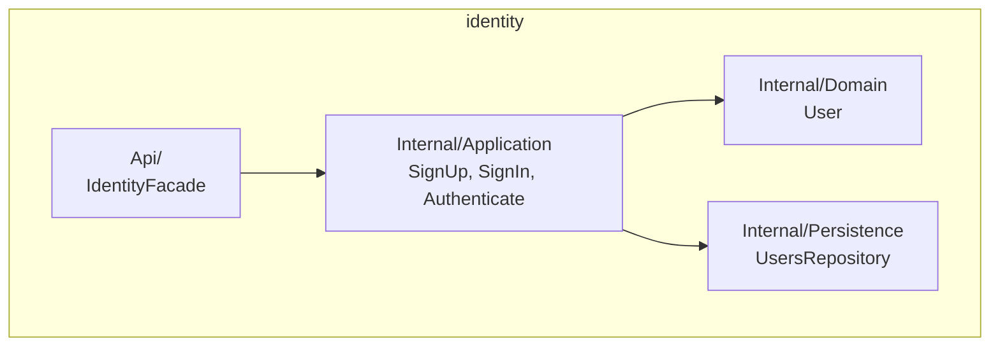

# identity — Module Overview

## Purpose

Owns the accounts, their sign-in and their single-use links, and is the
authoritative source of `identity.users` — the only table any other module's audit columns
(`created_by`, `updated_by`, `deleted_by`) point at.

## Public API

| Method | Input | Output | Called by |
|---|---|---|---|
| `IdentityFacade.CreateUser` | name, email, role | `User` and its activation link | `platform/web` (`POST /users`) |
| `IdentityFacade.CreateActivationLink`, `CreatePasswordReset` | user id | The link | `platform/web` |
| `IdentityFacade.ConfirmLink` | token, password | — | `platform/web` (`POST /account-links/confirm`) |
| `IdentityFacade.SignIn` | email, password | `Session` (bearer token) | `platform/web` (`POST /sessions`) |
| `IdentityFacade.Authenticate` | bearer token | user id, or rejected | `platform/web`'s auth middleware, on every other request |

Everything not listed above is `internal/` and unreachable from outside this
module — see [`../../05-architecture/module-structure.md`](../../05-architecture/module-structure.md).

## Component diagram

## Dependencies

| Depends on | Through | Why |
|---|---|---|
| none | — | `identity` is the base of the dependency graph in [`../module-catalog.md`](../module-catalog.md) |

## In-process events

| Event | Direction | Other module(s) involved |
|---|---|---|
| — | — | None yet: no module reacts to a sign-in or a new account today |

An in-process event is a synchronous call inside the same request, same
transaction, same release — never a queue or a broker.

---

**Related:** [`./data-model.md`](./data-model.md) · [`../module-catalog.md`](../module-catalog.md)
