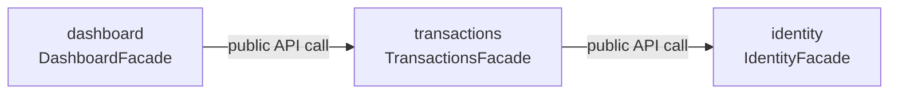

# 09 — Module Catalog

## Modules

| Module | Purpose | Owns | Public API | Status |
|---|---|---|---|---|
| `identity` | Sign up and sign in the single account a business uses | `users` | `IdentityFacade` | Evolving |
| `transactions` | Record income and expenses, their categories, subcategories, and budgets | `categories`, `subcategories`, `transactions`, `transaction_details`, `budgets` | `TransactionsFacade` | Evolving |
| `dashboard` | Compute KPIs and the 5 most recent transactions, on read | — (owns no table) | `DashboardFacade` | Evolving |

## Status legend

| Status | Meaning |
|---|---|
| Stable | The public API is safe to build on; a breaking change needs an ADR |
| Evolving | The public API is still gaining methods; expect changes between sprints |

Status describes the public API's own maturity, not whether the module is
running — the application deploys as one unit, so every module here ships
together, on every release, with no address or health check of its own. All
three start `Evolving`: V1 has not shipped yet.

## Dependencies between modules

A module with no outgoing arrow depends on nothing else in this catalog; one
with no incoming arrow has no internal consumer yet, which is not a defect —
`identity` has none today.

## Keeping this catalog current

A module earns a row here only after it has one in
[`module-boundaries.md`](../02-domain/module-boundaries.md) and a folder
copied from [`_template-module/`](./_template-module/README.md). A module
dropped from the domain map loses its row here in the same pull request.

---

**Related:** [`../02-domain/module-boundaries.md`](../02-domain/module-boundaries.md) · [`./_template-module/README.md`](./_template-module/README.md)
