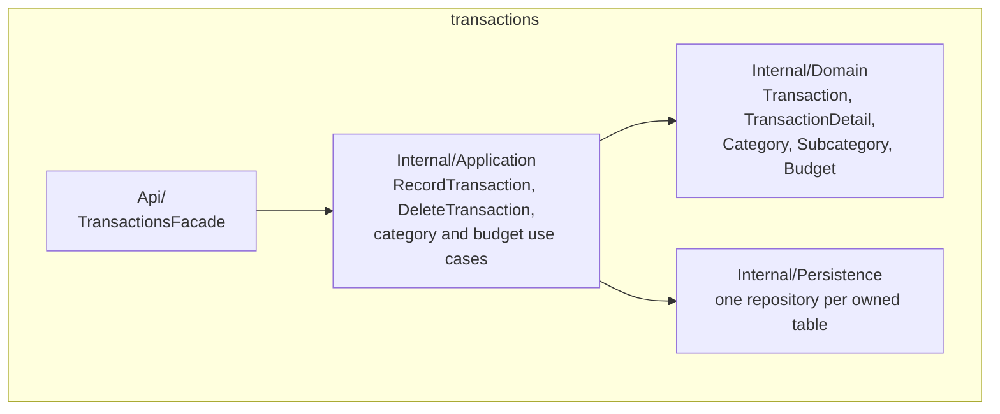

# transactions — Module Overview

## Purpose

Owns the whole recording capability: categories, subcategories, income and
expense transactions with their detail lines, and budgets. Everything a
business enters about its own money lives here.

## Public API

| Method | Input | Output | Called by |
|---|---|---|---|
| `TransactionsFacade.ListTransactions` | page, limit | page of `Transaction` | `platform/web`, `DashboardFacade` |
| `TransactionsFacade.RecordTransaction` | date, description, details[] | `Transaction` | `platform/web` |
| `TransactionsFacade.DeleteTransaction` | transaction id | — | `platform/web` |
| `TransactionsFacade.ListCategories` | page, limit, type? | page of `Category` | `platform/web` |
| `TransactionsFacade.CreateCategory` / `DeleteCategory` / `UpdateCategoryStatus` | name+type / id / id+isActive | `Category` / — / `Category` | `platform/web` |
| `TransactionsFacade.ListSubcategories` | category id, page, limit | page of `Subcategory` | `platform/web` |
| `TransactionsFacade.CreateSubcategory` / `DeleteSubcategory` / `UpdateSubcategoryStatus` | category id+name / ids / ids+isActive | `Subcategory` / — / `Subcategory` | `platform/web` |
| `TransactionsFacade.CreateBudget` / `ListBudgets` | category id, amount, period / page, limit | `Budget` / page of `Budget` | `platform/web` |
| `TransactionsFacade.GetTotals` | — | income/expense totals | `DashboardFacade` |

Everything not listed above is `internal/` and unreachable from outside this
module — see [`../../05-architecture/module-structure.md`](../../05-architecture/module-structure.md).

## Component diagram

## Dependencies

| Depends on | Through | Why |
|---|---|---|
| `IdentityFacade` | public API call | Attribute every write's `created_by`/`updated_by`, and a delete's `deleted_by` (BR-04) |

## In-process events

| Event | Direction | Other module(s) involved |
|---|---|---|
| — | — | None yet: `dashboard` reads through `GetTotals`/`ListTransactions`, a direct call, not an event |

An in-process event is a synchronous call inside the same request, same
transaction, same release — never a queue or a broker.

---

**Related:** [`./data-model.md`](./data-model.md) · [`../module-catalog.md`](../module-catalog.md)
