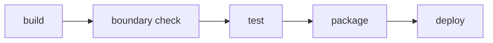

# 10 — CI/CD Pipeline

## One artifact, one pipeline

The application builds once, into one deployable artifact, in the
`package` stage below. Staging and production run that same artifact —
never a second build from the same commit — promoted forward through the
stages that follow. There is no per-module pipeline and no deploy order
between modules: the whole application moves together, or not at all.

`boundary check` runs straight after `build` and before `test`, matching
[`boundary-enforcement.md`](../05-architecture/boundary-enforcement.md): a
boundary violation makes the test results that would follow uninteresting,
so the pipeline stops before running them.

## Stages

| Stage | What it does | What makes it fail |
|---|---|---|
| `build` | Compiles the application from source | The code does not compile, or a dependency cannot be resolved |
| `boundary check` | Runs the stack's tool from [`boundary-enforcement.md`](../05-architecture/boundary-enforcement.md) against the whole tree | Any module reaches another module's `internal/` code |
| `test` | Runs the `unit` and `module-integration` layers from [`testing-strategy.md`](../11-quality/testing-strategy.md) | A test fails, or coverage drops below **NFR-07** (80% on changed files, 90% on the `transactions` module) |
| `package` | Assembles the one deployable artifact — a container image, per [`_stacks/csharp-aspnet.md`](../_stacks/csharp-aspnet.md) — and tags it with the commit | The artifact cannot be assembled |
| `deploy` | Promotes the artifact to an environment from [`environments.md`](./environments.md) and runs a smoke test | Staging: the `end-to-end` layer fails. Production: `GET /health` fails, or approval is not granted |

## When each stage runs

Per [`git-conventions.md`](../00-governance/git-conventions.md), code has three
permanent branches — `develop`, `qa`, `main` — and a change reaches `qa` or
`main` only by a pull request from the branch below it.

| Trigger | Stages that run |
|---|---|
| Every pull request into `develop`, `qa` or `main` | `build` through `package` — the artifact is built and proven before the merge, never deployed |
| A pull request merged into `qa` | All five stages; `deploy` targets `staging` |
| A pull request merged into `main` (a release from `qa`, or a `hotfix/` branch) | All five stages; `deploy` targets `production`, gated on manual approval |

## The migration job in `bud-tack-db`

The schema is not part of the artifact: it lives in `bud-tack-db`, per
[`ADR-005`](../05-architecture/decisions/records/ADR-005-fluentmigrator-for-schema-migrations.md).
Every pull request there builds `BudTack.Db.Migrations` with `dotnet build` and
runs `up`, `down`, `up` against an empty PostgreSQL service container — the
round trip in [`migrations.md`](../06-data/migrations.md). On `qa` and `main`
it runs `up` against that environment's database, as the migrator role, before
the application's `deploy` stage. Only the `dotnet` SDK runs; no Java runtime.

## The other repositories

Each repository's pipeline runs on every pull request into `develop` and blocks
the merge on failure, the same as the application's.

| Repository | Jobs, in order | What makes it fail |
|---|---|---|
| `bud-tack-portal` | `npm ci` → `ng lint` → `ng test --watch=false --coverage` → `ng build` → `docker build` (nginx image, tagged with the commit) | A lint error, a failing test, coverage under 80% on changed files (**NFR-07**), or a build or image error |
| `bud-tack-infra` | `docker compose config` → PostgreSQL and its roles → `docker compose --profile app up -d --build --wait` from the `develop` branch of `bud-tack-db`, `-api` and `-portal` → `GET /`, `GET /health` and `/api/` through the portal's proxy (`scripts/verify-stack.sh`) | An invalid Compose file, a role with more rights than `security-policy.md` allows, or a service that never reports healthy |
| `bud-tack-docs` | The release job on a `v*.*.*` tag only | — |

Per [`ADR-006`](../05-architecture/decisions/records/ADR-006-portal-image-behind-reverse-proxy.md),
the portal ships as its own nginx image that serves the Angular files and
forwards `/api/` and `/health` to the API. A release tags both images with the
same version, and `bud-tack-infra`'s Compose file for each environment pins that
one tag for both. The portal image is a client, not a second backend: "the one
artifact" above is still the API's image.

---

**Related:** [`../05-architecture/boundary-enforcement.md`](../05-architecture/boundary-enforcement.md) · [`../11-quality/testing-strategy.md`](../11-quality/testing-strategy.md)
