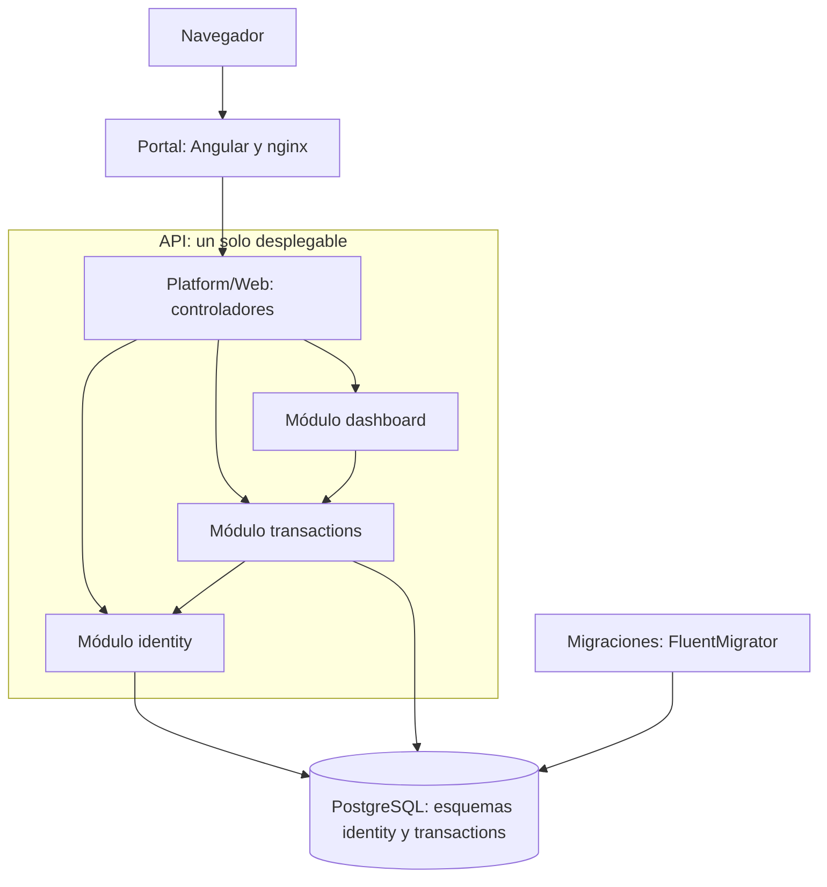
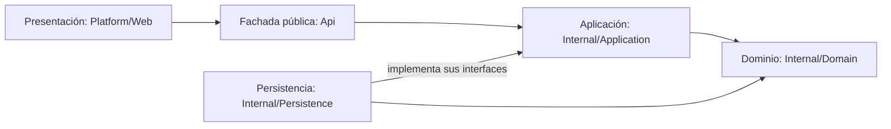

# Arquitectura

Este documento resume la arquitectura de Budget Tracker y su justificación frente a los
[requisitos](./requisitos.md). El detalle de cada decisión está en los
[ADR](./05-architecture/decisions/records) y en [`05-architecture`](./05-architecture).

## Estilo seleccionado

**Monolito modular con capas dentro de cada módulo**
([ADR-001](./05-architecture/decisions/records/ADR-001-modular-monolith-as-default.md)).

La aplicación se despliega como una sola unidad, dividida en tres módulos que corresponden a las
áreas del negocio. Cada módulo expone una fachada pública y oculta todo lo demás.

| Módulo | Responsabilidad | Requisitos | Datos |
|---|---|---|---|
| `identity` | Cuentas, inicio de sesión, roles y tokens | RF-01, RF-02, RF-10, RNF-02, RNF-03 | Esquema `identity` |
| `transactions` | Categorías, movimientos y presupuestos | RF-03 a RF-08 | Esquema `transactions` |
| `dashboard` | Indicadores calculados al consultar | RF-09 | Ninguno: lee a través de `TransactionsFacade` |

## Tecnologías

| Parte | Tecnología | Decisión |
|---|---|---|
| Lenguaje principal y API | C# con ASP.NET Core 10 (controladores MVC) | [ADR-002](./05-architecture/decisions/records/ADR-002-angular-dotnet-postgresql-stack.md) |
| Portal web | Angular 21 con TypeScript, servido por nginx | [ADR-002](./05-architecture/decisions/records/ADR-002-angular-dotnet-postgresql-stack.md), [ADR-006](./05-architecture/decisions/records/ADR-006-portal-image-behind-reverse-proxy.md) |
| Base de datos | PostgreSQL 17, un esquema por módulo | [ADR-004](./05-architecture/decisions/records/ADR-004-shared-database-and-per-piece-repositories.md) |
| Migraciones | FluentMigrator | [ADR-005](./05-architecture/decisions/records/ADR-005-fluentmigrator-for-schema-migrations.md) |

## Diagramas

### Componentes

El navegador solo habla con el portal, que reenvía las peticiones a la API. Las flechas entre
módulos son las únicas dependencias permitidas, y las fachadas son el único punto de entrada.



### Capas dentro de un módulo

La capa de presentación está una sola vez, en el proyecto anfitrión, y llama únicamente a las
fachadas. La aplicación define las interfaces de sus repositorios y la persistencia las implementa,
así que los casos de uso no dependen de la base de datos.



## Estructura del repositorio

La estructura de carpetas refleja los módulos y las capas.

```text
docs/                         requisitos, arquitectura, ADR y casos de prueba
infra/                        Docker Compose y scripts de verificación
src/
  db/                         migraciones con FluentMigrator
  portal/                     aplicación Angular
  api/
    src/
      BudTack.Api/            proyecto anfitrión
        Platform/Web/         controladores
        Platform/Config/      configuración
        Platform/Errors/      formato común de errores
        Platform/Logging/     registros estructurados
      BudTack.Identity/       módulo identity
        Api/                  fachada y contratos públicos
        Internal/Application/ casos de uso
        Internal/Domain/      entidades y reglas
        Internal/Persistence/ acceso a datos
      BudTack.Transactions/   módulo transactions, con las mismas carpetas
      BudTack.Dashboard/      módulo dashboard: solo fachada y contratos
    tests/
      boundary/               reglas de arquitectura
      unit/                   pruebas unitarias
      module-integration/     pruebas por módulo con PostgreSQL
      end-to-end/             pruebas de la API completa
```

## Justificación

| Necesidad | Cómo la atiende la arquitectura |
|---|---|
| RF-01, RF-02 y RF-10: cuentas y acceso | `identity` concentra la autenticación; los demás módulos solo conocen `IdentityFacade`. |
| RF-03 a RF-08: núcleo del negocio | `transactions` reúne las reglas BR-01, BR-02, BR-04, BR-05 y BR-06, que comparten datos y deben validarse juntas. |
| RF-09: reporte | `dashboard` no tiene tablas: calcula sobre lo que entrega `TransactionsFacade`, y por eso el saldo siempre está al día (BR-03). |
| RNF-01: V(G) ≤ 10 | Las reglas están en clases del dominio, sin base de datos ni framework. Refactorizar `MovementRules` o `SignUpRules` no afecta a otros módulos y sus pruebas unitarias protegen el cambio. |
| RNF-02: límite de intentos | Todo inicio de sesión entra por `POST /sessions`, así que el límite se aplica en un solo lugar. |
| RNF-03: hash y sal | `PasswordHasher` es interno de `identity`; ningún otro módulo puede leer ni tratar contraseñas. |

### Alternativas evaluadas

| Alternativa | Ventajas | Por qué no se eligió |
|---|---|---|
| Capas planas | Es la estructura más simple | Con tres áreas de negocio, las capas mezclan responsabilidades y los cambios cruzan todo el código |
| MVC como estilo general | Es simple y lo ofrece ASP.NET Core | Organiza por tipo técnico y no separa las áreas del negocio; aquí se usa solo en la presentación |
| Arquitectura hexagonal completa | Aísla el dominio de cualquier tecnología | Agrega adaptadores para una sola base de datos y un solo canal; se adopta solo la inversión de dependencias hacia los repositorios (`IMovementsRepository`) |
| Servicios independientes | Despliegue y escalado por servicio | Exige varios desplegables, comunicación en red y operación que no se justifican para este alcance |

### Compromisos aceptados

| Compromiso | Consecuencia |
|---|---|
| Un solo desplegable | Los módulos no se escalan ni se publican por separado |
| Una sola instancia de base de datos | Un fallo de PostgreSQL afecta a toda la aplicación |
| Sin claves foráneas entre módulos | La integridad entre `identity` y `transactions` depende de la aplicación ([ADR-004](./05-architecture/decisions/records/ADR-004-shared-database-and-per-piece-repositories.md)) |
| Fachadas explícitas | Ampliar lo que expone un módulo requiere cambiar su contrato público |
| Un proyecto por módulo | Hay más proyectos y más configuración que en un diseño plano |

## Cómo favorece la mantenibilidad

| Principio | Mecanismo en el proyecto | Comprobación |
|---|---|---|
| Separación de responsabilidades | Controladores, casos de uso, reglas y acceso a datos están en capas distintas | Estructura de carpetas |
| Bajo acoplamiento | Un módulo solo usa la fachada de otro, y las dependencias van en un solo sentido: `dashboard` → `transactions` → `identity` | Compilador (`internal`) y `Transactions_dependsOnNeitherDashboardNorHost`, `Identity_dependsOnNoOtherModule` |
| Encapsulamiento | Todo lo que está en `Internal` es inaccesible desde fuera | `IdentityInternal_exposesNoPublicTypes`, `TransactionsInternal_exposesNoPublicTypes`, `DashboardInternal_exposesNoPublicTypes` |
| Alta cohesión | Cada módulo agrupa un área del negocio con sus propios datos | Esquema por módulo y `Dashboard_touchesNoDatabase` |

Las reglas de arquitectura se ejecutan en cada pull request, en la etapa `boundary check` del CI.
