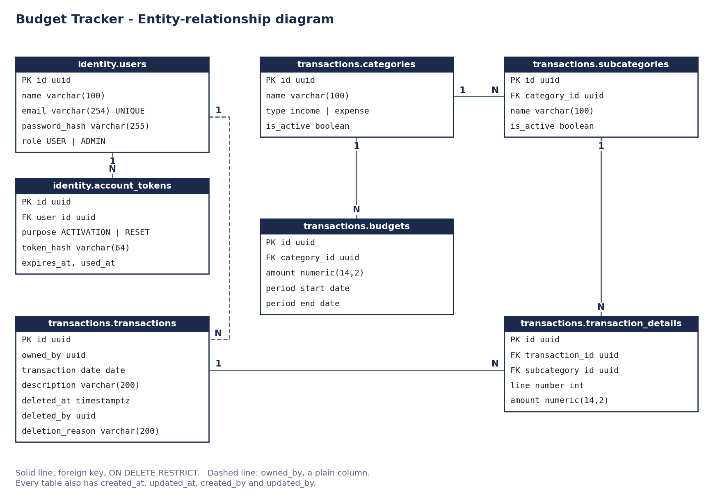

# bud-tack-db

> Budget Tracker - Database: schema, seeds and migrations

Part of the **Budget Tracker** full-stack project — team `budget-tracker`, Complementaria III - Desarrollo Fullstack 2026-B.
Governance and documentation live in [`bud-tack-docs`](https://github.com/code-corhuila/bud-tack-docs).

## Migrations

The one migration sequence of the database, with **FluentMigrator** on .NET 10 —
no Java runtime (ADR-005). Policy: `06-data/migrations.md` in `bud-tack-docs`.

Start the local PostgreSQL from `bud-tack-infra` first, then:

```bash
cp .env.example .env
dotnet run --project src/BudTack.Db.Migrations -- up     # apply pending migrations
dotnet run --project src/BudTack.Db.Migrations -- list   # show applied / pending
dotnet run --project src/BudTack.Db.Migrations -- down   # roll everything back to 0
```

It connects with `MIGRATOR_DATABASE_URL`, as `bud_tack_migrator`; the API never
does. The versions live in `public.schema_version`.

| Rule | Detail |
|---|---|
| Location | `src/BudTack.Db.Migrations/Migrations/`, one class per migration |
| Version | `[Migration(yyyyMMddHHmm)]`, the UTC time it was written |
| Name | `<Module><NNN>_<Change>`, e.g. `Transactions001_CreateCategories` |
| Schema | Every table `.InSchema("identity")` or `.InSchema("transactions")` |
| Rollback | Additive changes inherit `AutoReversingMigration`; any other has a real `Down()` |

The API's role gets `SELECT, INSERT, UPDATE, DELETE` on every table the migrator
creates in those schemas automatically (default privileges, `Platform001`).

| Version | Migration | Story | Creates |
|---|---|---|---|
| `202611041500` | `Platform001_CreateSchemas` | Sprint 0 | Schemas `identity` and `transactions`, and the app role's rights on them |
| `202611052230` | `Identity001_CreateUsers` | HU-01 | `identity.users`: unique email (`idx_users_email`), stored lowercase (`ck_users_email_lowercase`), a non-blank name, the password only as a hash |
| `202611060035` | `Transactions001_CreateCategories` | HU-02 | `transactions.categories`: an owner (`owned_by`), `income` or `expense`, a non-blank name unique per owner and type ignoring case (`idx_categories_owned_by_type_name`), `is_active` |
| `202611060036` | `Transactions002_CreateSubcategories` | HU-02 | `transactions.subcategories`: a name unique per category ignoring case; its key to the category is `ON DELETE RESTRICT`, so a category that owns a subcategory cannot be deleted (BR-05) |
| `202611061610` | `Transactions003_CreateTransactions` | HU-04 to HU-06 | `transactions.transactions`: an owner, a date, a non-blank description up to 200 characters; a soft delete sets `deleted_at` and `deleted_by` together (BR-04); a partial index serves the owner's history, newest first |
| `202611061611` | `Transactions004_CreateTransactionDetails` | HU-04 | `transactions.transaction_details`: an amount `numeric(14,2)` above zero against one subcategory, and no type column (BR-01); both keys `ON DELETE RESTRICT`, so a subcategory in use cannot be deleted (BR-05) |
| `202611061625` | `Transactions005_AddDetailLineNumber` | HU-04 | `line_number` on `transaction_details`: the lines keep the order they were entered (unique per transaction, from 1); existing lines are numbered by `created_at, id` |
| `202611061710` | `Transactions006_CreateBudgets` | HU-07 | `transactions.budgets`: an owner, a category, an amount `numeric(14,2)` above zero and a period that ends after it starts, both checked so a change can never break them (BR-06); deleted physically; its key to the category is `ON DELETE RESTRICT`, so a category with a budget cannot be deleted (BR-05) |
| `202611082300` | `Identity002_AddUserRole` | HU-09 | `role` on `identity.users`: `USER` or `ADMIN`, `USER` by default (ADR-007) |
| `202611082301` | `Identity003_SeedUsers` | HU-09 | One test user per role, with BCrypt hashes (ADR-008) |
| `202611092100` | `Identity004_AddAccountTokens` | HU-10 | `identity.account_tokens`: single-use links, only their hash (ADR-010); `password_hash` optional until an account is activated |
| `202611092101` | `Transactions007_ShareCatalog` | HU-12 | Removes `owned_by` from categories and budgets; a category name is unique per type (ADR-009) |
| `202611092102` | `Transactions008_AddDeletionReason` | HU-06 | `deletion_reason`, set together with `deleted_at` (BR-04) |

## Seed users

Test accounts for local use only, created by `Identity003_SeedUsers`. A real
deployment must replace them before opening to anyone.

| Role | Email | Password |
|---|---|---|
| `ADMIN` | `admin@budgettracker.test` | `Admin-2026!` |
| `USER` | `usuario@budgettracker.test` | `Usuario-2026!` |

## Entity-relationship diagram



Solid lines are foreign keys. Dashed lines are the plain `owned_by` columns: they
cross a module boundary, so `IdentityFacade` validates them instead of a database
constraint (`06-data/database-conventions.md`).

## Round trip

The check CI runs on every pull request: up, down to 0, up
again with the same schema, plus the rules of each table tried as the app role
— build first:

```bash
dotnet build -c Release
PG_CONTAINER=bud-tack-postgres-1 sh scripts/round-trip.sh
```

## Branching

Three permanent branches. **None of them accepts a direct commit** — you enter through a child
branch and leave through a Pull Request.

```
develop  <--PR--  feat/... fix/... chore/...
qa       <--PR--  develop
main     <--PR--  qa (release)   hotfix/...
```

`develop` is the default branch: start every task from it. `main` requires **1 approval from
`ariel5253`**. On `develop` and `qa` the team sets its own review rule.

Commit and branch naming: `00-governance/git-conventions.md` in `bud-tack-docs`.
